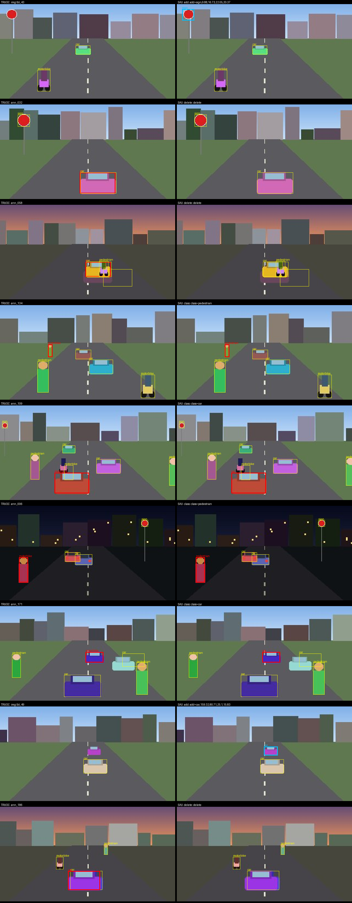

# T11 · Label Error Review Prioritizer
### G02 · Hoàng Quốc Mạnh · Day 06 Data Governance

**Bài toán:** ~205 bounding box (55 ảnh) bị chèn 4 loại lỗi — sai class, lệch box, box trùng, thiếu box.
Người kiểm tra chỉ duyệt được **10 mục**. Chọn 10 mục nào để bắt nhiều lỗi nhất?

**Ý tưởng:** chỗ nào **nhãn người** và **detector** bất đồng thì chỗ đó đáng nghi.

Ví dụ `ann_006`: người ghi *motorbike*, model ghi *pedestrian* (conf 0.86) cùng chỗ (IoU 0.83) → ảnh có đầu tròn, thân dài → người gán sai.

---

## 4 detector → 1 điểm nghi ngờ

| Lỗi | Dấu hiệu | Điểm |
|---|---|---|
| class swap | IoU ≥ 0.5, khác class | conf model |
| box shift | 0.05 < IoU < 0.6 | (0.6 − IoU)/0.6 × conf |
| duplicate | 2 box người cùng class, IoU ≥ 0.5 | IoU (chỉ 1 box/cặp) |
| missing | model conf ≥ 0.5, không chạm box nào | conf → `img:<id>` |

`score = max` · ngưỡng chọn trên **dev** (38 ảnh), đóng băng trong `configs/lab.yaml` · không dùng tên ID (`ann_dXX`) làm đặc trưng.

Pipeline 1 lệnh: `load (sha256) → process → rank top-10 → review → decide`

---

## Baseline vs PoC (dev, nhãn tự gán)

| Run | Lỗi trong top-10 | Precision@10 | Wilson 95% CI |
|---|---|---|---|
| Random (seed 42) | 1/10 | 0.10 | [0.02, 0.40] |
| **PoC** | **9/10** | **0.90** | [0.60, 0.98] |

Nguồn: `reports/t11_dev_baseline_vs_poc.md` (sinh bằng `tools/t11_dev_compare.py`).
Heldout chính thức (Error Recall@10, trần 0.909) cần `gt/` của giảng viên.

---

## Human-in-the-loop + quyết định

- `contact_sheet.html` tự sinh mỗi lần chạy: ảnh + box người/model, chọn edit/reject/approve/escalate/skip, Export CSV
- Vòng review thật: **9 lỗi sửa** (4 đổi class, 3 xoá duplicate, 2 thêm box missing), 1 reject
- Sửa trên **bản sao** → `corrected_annotations.csv`, diff `label_changes.csv`, `audit_log.jsonl` ghi ai/khi nào/vì sao
- **Decision: REWORK · HIGH_CONFIRMED_ERROR_RATE** — 9/10 = 90% ≥ 30% → lô nhãn lỗi hệ thống, trả vendor

---

## Failure modes & bước tiếp

- **`ann_096`**: model tự tin 0.94 nói pedestrian, nhưng ảnh có bánh xe → nhãn motorbike đúng. Pipeline tin model như nhau cho mọi cặp class → người duyệt đã `reject`.
- **`img:lbl_20`**: model báo biển báo (0.57) trên bãi cỏ trống → ngưỡng missing 0.5 thấp.
- **Duplicate**: 2 box giống hệt nhau → không biết box nào là bản sao.

**Tiếp theo:** hiệu chỉnh độ tin model theo cặp class · cleanlab làm đối chứng · 2 detector bất đồng.

Tái lập: offline · seed 42 · `pytest -q` → 74 passed, 39 skipped (cần gt/).
